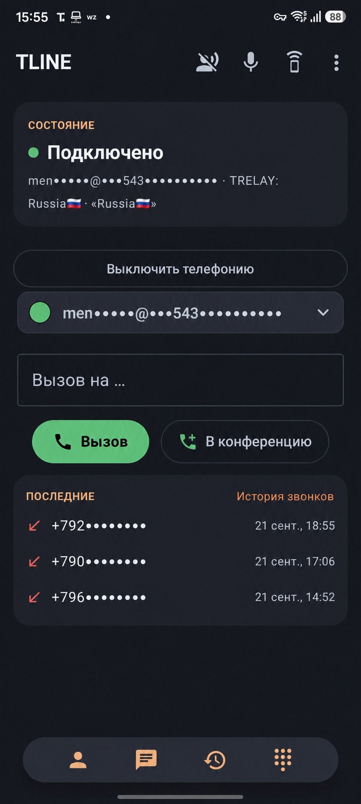

<h1 align="center">
  <br>
  TLINE
</h1>

<p align="center"><b>SIP-телефон для Android, который понимает переключения TRELAY.</b></p>

<p align="center">
  
  
  
  
</p>

<p align="center">
  
</p>

**TLINE** — Android-клиент SIP-телефонии на базе
[baresip-studio](https://github.com/juha-h/baresip-studio) и библиотеки
[baresip](https://github.com/baresip/baresip). От исходного приложения он сохраняет зрелое
телефонное ядро, но получает отдельный пакет `com.tline.phone`, интерфейс TLINE и прямую связку с
[TRELAY](../TRELAY-Android).

## Зачем TLINE нужен TRELAY

TRELAY отвечает за VPN-маршрут телефонии и резервные серверы. Когда активный сервер меняется,
TRELAY адресно сообщает об этом TLINE. Клиент пересоздаёт SIP-транспорт и сразу запускает
перерегистрацию — не ждёт штатного таймера и не оставляет входящие звонки на старом маршруте.

TLINE также показывает состояние телефонного маршрута TRELAY, умеет отвечать на входящий вызов
прямо из уведомления и поддерживает полноэкранный экран вызова там, где это разрешает Android.
Без TRELAY приложение остаётся обычным SIP-клиентом.

## Что изменено относительно исходного приложения

- отдельный бренд, пакет и тёмный интерфейс TLINE;
- быстрый экран добавления SIP-профиля;
- немедленная перерегистрация при failover TRELAY и ручном pull-to-refresh;
- состояние маршрута и сервера TRELAY на главном экране;
- крупные кнопки входящего вызова и ответ из системного уведомления;
- сторож регистрации и восстановление сервиса после выгрузки Android.

## Сборка

Нужны JDK 21, Android SDK Platform 37, NDK `29.0.14206865` и CMake `3.31.6`.
Нативные библиотеки лежат в `distribution/`; инструкции по их пересборке находятся в подмодуле
`libbaresip-android`.

```powershell
$env:JAVA_HOME = 'D:\emulandroid\jbr'
$env:ANDROID_HOME = 'C:\Users\Windows\AppData\Local\Android\Sdk'
$env:ANDROID_SDK_ROOT = $env:ANDROID_HOME
./gradlew.bat --no-daemon :app:assembleDebug :app:testDebugUnitTest
```

APK после сборки: `app/build/outputs/apk/debug/app-debug.apk`.

## Приватность

TLINE не использует сторонние push-сервисы и не отправляет адресную книгу разработчику. SIP-логин,
пароль, история и настройки хранятся локально на устройстве. Подробности — в
[PrivacyPolicy.txt](PrivacyPolicy.txt).

## Происхождение и лицензия

Проект является производной работой от baresip-studio. Исходное авторство сохранено в
[LICENSE](LICENSE); код распространяется по BSD-3-Clause. У отдельных нативных библиотек и кодеков
есть собственные лицензии — они перечислены в приложении и в соответствующих исходных проектах.
